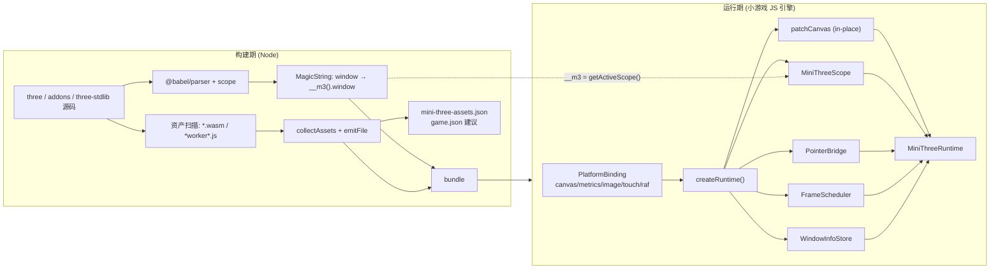
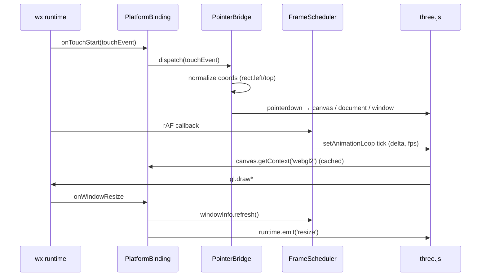

# 02 · 架构设计

## 2.1 两阶段模型

适配层被刻意拆成**构建期**与**运行期**两个互不依赖的部分。运行期不需要 Node、不需要构建工具；构建期不接触 `wx`。



## 2.2 分层与依赖方向

```
src/types.ts               纯类型，零依赖
src/scope.ts               作用域协议（依赖 types）
src/polyfills/*            自包含 W3C 迷你实现（依赖 types / 彼此）
src/core/*                 平台无关运行时（依赖 polyfills / scope / types）
src/platforms/*            平台适配（依赖 core / wx-types）
src/build/*                构建插件（Node，只依赖 scope-rewrite / assets，不依赖 core）
src/index.ts               汇总导出
```

依赖规则（由 CI 与 `AGENTS.md` 共同约束）：

- `core/*` **不得** import `platforms/*`；
- `build/*` **不得** import `core/*` 或 `platforms/*`；
- `polyfills/*` **不得** import `core/*`；
- `src/**` **不得** import `three`（`three` 只是可选 peer）；
- 任何文件都不得直接写 `globalThis.window = ...`，只有 `installGlobals()` 可以，且必须返回还原函数。

## 2.3 运行期数据流

### 初始化

1. `createWeChatGameRuntime(options)` → `createWeChatGameBinding()`。
2. `getScreenCanvas(wx)` 按 `options.canvas` → `GameGlobal.screencanvas` → `globalThis.canvas` → `wx.createCanvas()` 的顺序取**唯一**上屏画布，并做模块级缓存。
3. `detectCapabilities()` 优先用 `wx.createOffscreenCanvas()` 探测 WebGL2；上屏画布已解析后允许显式回退到第二次 `wx.createCanvas()`（[ADR-0007](./adr/0007-capability-probe-fallback.md)）。探测不到时返回 `undefined`，按基础库版本推断并在 `webgl2Source` 标明，**绝不把「探测不到」当成 `false`**。
4. `createDocument()` 建出 `document` / `body` / `screen` 等容器；`createElement('canvas')` 走 `webgl2` 离屏画布，失败降级 `2d` 并告警。
5. `patchCanvas()` 在原对象上定义 `style` / `clientWidth` / `getBoundingClientRect` / `getContext` / EventTarget 方法，并注册到 `HTMLCanvasElementShim` 的 `WeakSet`。
6. 组装 `MiniThreeScope`（polyfill 构造器 + 领域对象 + live getter），`setActiveScope(scope)` 让 `__m3()` 生效。
7. `PointerBridge` 订阅 `wx.onTouch*`；`WindowInfoStore` 订阅 `wx.onWindowResize`；`FrameScheduler` 包住 rAF。
8. 返回可 `dispose()` 的 `MiniThreeRuntime`。

### 一帧内发生的事



## 2.4 关键抽象

| 抽象 | 文件 | 契约要点 |
| --- | --- | --- |
| `PlatformBinding` | `core/platform.ts` | 平台向运行时提供的一切：`rawCanvas`、`capabilities`、`imageFactory`、`getCanvasRect`、`createOffscreenCanvas`、`watchTouch`、`watchVisibility`、rAF、`now`、`dispose` |
| `MiniThreeScope` | `scope.ts` | 三方代码可见的「伪 window」；`window === self === globalThis === scope` |
| `MiniThreeRuntime` | `core/runtime.ts` | 唯一生命周期对象；只读能力 + `handleTouch` / `resize` / `installGlobals` / `on` / `dispose` |
| `PointerBridge` | `core/pointer.ts` | touch → pointer/mouse 状态机，pointerId、capture、cancel |
| `FrameScheduler` | `core/frames.ts` | rAF 包装、delta、fpsCap、FPS 测量 |
| `WindowInfoStore` | `core/window-info.ts` | 尺寸/DPR、封顶、resize 广播 |
| `Diagnostics` | `core/diagnostics.ts` | 分级日志、`warnOnce`、`capabilityReport` |

## 2.5 架构不变量（AI 必读，不得破坏）

1. **只有一个上屏画布**：`wx.createCanvas()` 只在 `getScreenCanvas()` 中调用一次并被缓存；任何新增代码不得再调用它。
2. **对象身份不变**：canvas / image 永远是 `wx` 返回的那个对象；禁止 `new Proxy` 包装、禁止 `Object.setPrototypeOf`、禁止返回克隆体。
3. **默认零全局污染**：只有 `installGlobals()` 会写 `globalThis`，且必须可逆；`getActiveScope()` 是三方代码访问 shim 的唯一通道。
4. **`three` 零运行时依赖**：`src/` 不 import `three`，`package.json` 中它只是 optional peer。
5. **平台无关核心**：`core/` 不认识 `wx`；平台差异全部收敛到 `platforms/` 的 `PlatformBinding`。
6. **构建/运行隔离**：`build/` 只在 Node 执行，不引用运行时模块，不引入 `fs` 到小游戏 bundle。
7. **单一生命周期**：所有订阅、定时器、全局注入都登记到 `disposers`，`dispose()` 后不留副作用。
8. **WebGL2 优先**：`document.createElement('canvas')` 默认 `webgl2`；无 WebGL2 时必须发出明确告警。
9. **改写只针对自由变量**：AST 重写必须通过 `path.scope.hasBinding(name, true)` 判定，禁止全局字符串替换。
10. **破坏性行为必须显式**：全局注入、WebGPU 重写、深度缓冲补丁等一律 opt-in。

## 2.6 失败模式与降级

| 情况 | 行为 |
| --- | --- |
| 没有 `wx`（Node/浏览器） | `createWeChatGameRuntime({ wx })` 可注入；`browser` 平台用真实 DOM |
| `createOffscreenCanvas` 不可用 | 探测回退到主画布类型；仍不可判定则标记 `webgl2Source: 'inferred'`；`createCanvas()` 抛明确错误；文档提示升级基础库 |
| WebGL2 不可用 | `diagnostics.warn` + 能力报告；不静默降级到 WebGL1（three ≥ r163 也无法工作） |
| `wx.createImage` 缺失 | 回退 `OffscreenCanvas.createImage()`，再失败抛可操作错误 |
| `typeof window` 在 runtime 之前被读取 | `emptyScope` 让 `typeof` 返回 `'object'`，真正取属性时抛带指引的错误 |
| AST 解析失败 | 插件记录 `parseFailures`、告警并跳过该模块，绝不产出半改写代码 |
| 找不到 wasm/worker | 记录 `missingAssets` 并告警，不中断构建 |

## 2.7 与 H5 双端的关系

`browser` 平台用真实 `document.createElement('canvas')`，同样走 `patchCanvas`（幂等地补充属性）。因为 shim 全部在 `MiniThreeScope` 里，**真实 `window` / `document` 从未被覆盖**，所以同一份 `scene.ts` 能在浏览器与小游戏里同时运行。这也是 H5 双端构建可以复用同一套业务代码的基础。
