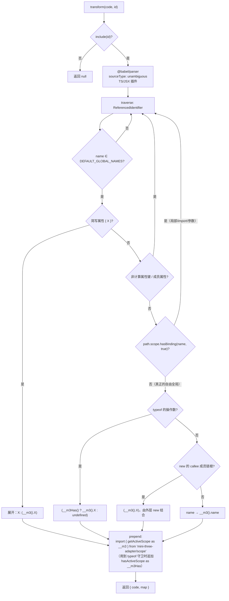
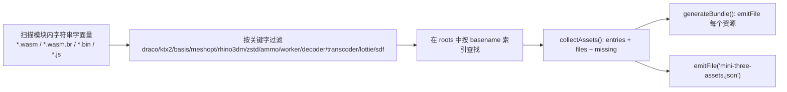

# 05 · 构建插件原理与配置

> 插件是「不 fork three」这一路线成立的关键。它只在 **Node 构建期**运行，产物不会进入小游戏运行时。

## 5.1 为什么必须改写三方模块

微信小游戏没有 `window` / `document` / `Image` / `URL` 等全局（[官方 Adapter 文档](https://developers.weixin.qq.com/minigame/dev/guide/runtime/adapter.html)）。three 及其 addons 会直接引用这些自由变量。两种办法：

1. 把这些 shim 挂到 `globalThis`（官方 `weapp-adapter` 路线）→ 简单但不可逆、H5 双端冲突。
2. 在编译期把三方模块中的**自由引用**改成 `__m3().window` → 运行时由 `MiniThreeScope` 提供。

本项目选 2，并额外用 AST 作用域分析保证精确。

## 5.2 改写流程（`src/build/scope-rewrite.ts`）



关键正确性保证：

| 场景 | 处理 |
| --- | --- |
| `function f(window) { return window.x }` | `hasBinding` 命中 → **不改写** |
| `const o = { window: 1 }` | 非计算属性键 → 不改写 |
| `foo.window` | 成员属性 → 不改写 |
| `import { window as w } from 'x'` | import 绑定 → 不改写 |
| `new TextDecoder()` | 改写成 `new (__m3().TextDecoder)()`。**括号不能省**：`new __m3().TextDecoder()` 会被解析成 `(new __m3()).TextDecoder()`，于是 scope 对象被当成构造函数、类被普通调用，报 `Class constructor ... cannot be invoked without 'new'` |
| `new OffscreenCanvas(1, 1).getContext('2d')` | 只给链根加括号 → `new (__m3().OffscreenCanvas)(1, 1).getContext('2d')`，语义不变 |
| `const o = { TextDecoder }` | 展开成 `{ TextDecoder: (__m3().TextDecoder) }`。简写属性的 key 与 value 是两个**区间相同**的独立节点，原地替换会产出 `{ __m3().TextDecoder }` 这种**语法错误**，因此必须展开 |
| `typeof window !== 'undefined'` | 改写成 `typeof __m3().window !== 'undefined'`，结果 `'object'`，three 走浏览器分支（正是我们想要的） |
| `typeof document !== 'undefined'` | 改写成 `typeof (__m3Has() ? __m3().document : undefined)`：runtime 未创建时得到 `'undefined'` 而不是抛错；runtime 存在时照常返回真实对象 |
| `URL.createObjectURL(blob)` | `URL` 与 `Blob` 都改写 |
| 解析失败 | 记录 `parseFailures` + `ctx.warn`，**原样返回**，绝不产出半改写代码 |

> 为什么只有 `new` 需要括号：`typeof`、`in`、`delete`、`?.`、`instanceof` 右侧等位置，`__m3().X` 的优先级都足够高；唯一优先级倒挂的是 `new`。

> 为什么 `typeof` 要单独守卫：`typeof` 是本应永不抛错的运算符，而 `emptyScope` 只对 `document` / `navigator` / `screen` / `location` / `history` 返回 `undefined`，其余键（`TextDecoder`、`HTMLCanvasElement`、`Blob` …）仍然抛可读错误。不加守卫时，库顶层的 `typeof TextDecoder !== 'undefined'` 会在 runtime 创建之前直接崩掉，而报错指向适配层，极易误判为「初始化顺序写错」。守卫只加在 `window/self/globalThis` 之外的名字上，因为这三个在 `emptyScope` 里恒指向自身。

> 守卫的边界：它只覆盖 `typeof X` 这种**直接操作数**。`typeof window.document` 的操作数是成员表达式，插件唯一能改的是 `window`，因此那条路径靠 `emptyScope` 把 `document` 读作 `undefined` 来兜住（见 [ADR-0009](./adr/0009-placeholder-scope-environment-globals.md)）。

`globalThis` **故意不在**默认清单里：three 会用它挂调试钩子（`__THREE_DEVTOOLS__` 等），改写会破坏这些逻辑。

`forceUndef: ['createImageBitmap']`：这些名字同样被改写，但作用域里恒为 `undefined`，于是 three 的 `typeof createImageBitmap !== 'undefined'` 判定为假，自动走非 Blob 分支。宿主环境提供了该 API 却没有原生 `Blob` 实现时，这个开关可以让 three 绕开不可用的代码路径。

## 5.3 默认 include 规则

命中以下路径（Vite/Rollup 的 `id` 会被规范化为 `/`）：

```
/node_modules/three/...
/node_modules/three@<version>/...
/node_modules/three-stdlib/...
/node_modules/@react-three/...
/node_modules/@tresjs/...
/node_modules/.vite/deps/three*          # Vite 预打包产物兜底
```

应用代码默认**不改写**。若确实需要，设 `includeUserCode: true`（会跳过 `mini-three-adapter` 自身）。
`vite.ts` 的 `config()` 额外设置 `optimizeDeps.exclude`，避免 Vite 把 three 预打包成一个不透明显式的 blob。

## 5.4 WebGPU 策略

微信小游戏没有 WebGPU，而 three r180+ 主推 `three/webgpu`。插件检测到 `from 'three/webgpu'` 时：

| `webgpu` | 行为 |
| --- | --- |
| `'warn'`（默认） | 构建告警，记入 `report.webgpuWarnings` |
| `'error'` | 直接失败，强制改用 `WebGLRenderer` |
| `'rewrite'` | 把 `three/webgpu` → `three`、`WebGPURenderer` → `WebGLRenderer`（**仅适用于未使用 TSL/NodeMaterial 的简单场景**） |
| `'ignore'` | 不处理 |

> `'rewrite'` 是有损的：`MeshStandardNodeMaterial`、TSL、`PostProcessing` 没有 WebGLRenderer 等价物，不能靠重命名解决。复杂 WebGPU 项目应改用 WebGL 构建目标。

## 5.5 资源收集（`src/build/assets.ts`）



默认搜索目录：`node_modules/three/examples/jsm/libs`、`node_modules/three/examples/jsm`、`node_modules/three-stdlib`、`public`、`static`，以及用户 `roots`。

`mini-three-assets.json` 内容：

```json
{
  "generatedBy": "mini-three-adapter",
  "outputDir": "assets/three",
  "entries": [{ "reference": "draco_decoder_gltf.wasm", "source": "...", "destination": "assets/three/draco_decoder_gltf.wasm", "kind": "wasm" }],
  "gameJsonSuggestion": {
    "workers": { "path": "assets/three", "isSubpackage": true },
    "subpackages": [{ "name": "three-assets", "root": "assets/three/" }]
  },
  "decoderPaths": { "draco": "assets/three/" },
  "build": { "modulesScanned": 12, "rewrites": 87, "missingAssets": [] }
}
```

约定与限制：

- 微信 Worker 配置只支持**一个目录**，所以 worker 与 wasm 统一输出到同一个 `outputDir`。
- `brotli: true` 时若存在 `xxx.wasm.br` 会一并拷贝；`WXWebAssembly.instantiate` 支持 `.wasm.br`（[官方文档](https://developers.weixin.qq.com/minigame/dev/guide/performance/perf-webassembly.html)）。
- Worker 分包需先 `wx.preDownloadSubpackage({ packageType: 'workers' })` 再 `wx.createWorker()`，且**并发最多 1 个 Worker**。
- 找不到资源时只告警并记入 `missingAssets`，不阻断构建——decoder 可能由业务自行放置。

运行时设置 decoder 路径示例：

```ts
import { DRACOLoader } from 'three/addons/loaders/DRACOLoader.js';
const draco = new DRACOLoader();
draco.setDecoderPath('assets/three/'); // 与 manifest.decoderPaths.draco 一致
```

## 5.6 Vite / Rollup 差异

| | Vite | Rollup |
| --- | --- | --- |
| 入口 | `mini-three-adapter/vite`（default export `miniThree`） | `mini-three-adapter/rollup`（named `miniThree`） |
| 额外 hook | `config()` 设置 `optimizeDeps.exclude` | 无 |
| `enforce` | `'pre'` | `'pre'` |
| 资源输出 | `generateBundle` 内 `emitFile` | 同 |
| 高级 API | 通过 `/rollup` 子路径获取 | 直接导出 |

## 5.7 调试构建问题

```ts
const plugin = miniThree({ debug: true, report: true });
// 构建后（在 CI 或插件宿主中）
console.log(plugin.api.report());
```

| 现象 | 查哪里 |
| --- | --- |
| three 里仍出现裸 `window` | `report.modulesScanned` 是否为 0 → 调整 `include`；检查 Vite 是否预打包 |
| 局部变量被误改 | `report.globalsSeen`；补 `tests/scope-rewrite.test.ts` 用例 |
| 解析报错 | `report.parseFailures`，考虑给 `rewrite` 加语法插件或 `exclude` 该模块 |
| worker/wasm 没进包 | `report.assetReferences` / `missingAssets`；补 `roots` |
| 包体过大 | 参照 `gameJsonSuggestion` 分包；`manualChunks` 见 [`examples/wechat-minigame/vite.config.ts`](../examples/wechat-minigame/vite.config.ts) |

### 按报错文案反查

| 报错 | 含义 | 处理 |
| --- | --- | --- |
| `Class constructor xxx cannot be invoked without 'new'`（栈顶常是 `GLTFLoader.js:444`） | 改写产物把 `new TextDecoder()` 变成了 `(new __m3()).TextDecoder()` | 升级到含本修复的版本；宿主侧临时补丁见下 |
| `SyntaxError: Unexpected token '.'`，指向 `{ __m3().xxx }` | 对象简写属性被原地替换 | 同上 |
| `Scoped global "document" was read before a runtime was created` | 真的在 runtime 之前读了 `document`（不是 `typeof`）；`document` 本身已不再抛错，这个文案现在只会出现在 `TextDecoder` / `HTMLCanvasElement` 这类真实 API 上 | 按 [`docs/07`](./07-integration-guide.md#74-入口改造最关键的一步) 调整入口顺序 |
| `new __m3().X` 残留 | 适配层版本过旧 | 检查 `dist` 里的重写器版本，清理缓存后重建 |

临时规避（仅用于旧版本）：在适配层插件**之后**（`enforce: 'post'`）跑一段产物级正则，把 `new __m3().X()` 改成 `new (__m3().X)()`。它依赖访问器名与「空参数」两个特征，适配层改了默认 `accessor` 就会静默失效，因此修复到位后应当删除。
